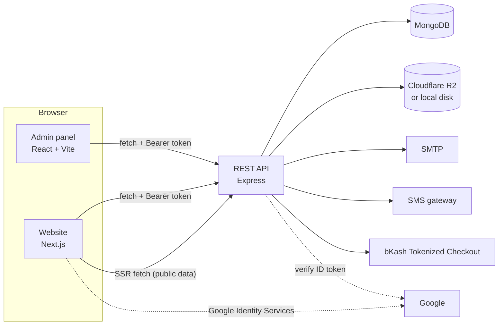

# Architecture

## Overview



- The **website** renders public pages (home, search, biodata pages, static pages) on the server for SEO, calling the API over the internal network (`API_URL`). Signed-in features run in the browser and call the public API URL (`NEXT_PUBLIC_API_URL`) with a JWT.
- The **admin panel** is a static single-page app. It only talks to the API, with a separate staff token.
- The **API** owns all data and rules. Neither front end talks to MongoDB or storage directly.

## Monorepo

| Package           | Depends on             | Notes                                                                             |
| ----------------- | ---------------------- | --------------------------------------------------------------------------------- |
| `packages/shared` | —                      | No dependencies, runs in Node and the browser. Imported by every other package.   |
| `packages/ui`     | `shared`, React (peer) | Shipped as source; Next.js transpiles it (`transpilePackages`), Vite handles JSX. |
| `apps/api`        | `shared`               |                                                                                   |
| `apps/web`        | `shared`, `ui`         |                                                                                   |
| `apps/admin`      | `shared`, `ui`         |                                                                                   |

See [ADR 0001](adr/0001-monorepo.md).

## The biodata schema

[`packages/shared/src/biodata/schema.js`](../packages/shared/src/biodata/schema.js) lists every section (general, address, education, family, personal, faith, occupation, marriage, expectation, contact, pledge) and every field with its type, bilingual label, options, limits, and rules:

| Property    | Effect                                                                                                                 |
| ----------- | ---------------------------------------------------------------------------------------------------------------------- |
| `type`      | `text`, `textarea`, `number`, `height`, `date`, `select`, `multiselect`, `yesno`, `check`, `phone`, `email`, `entries` |
| `required`  | Must be filled before the biodata can be submitted for review                                                          |
| `showIf`    | Field exists only when the rule passes, e.g. hijab question for Muslim brides, gotra for Hindus                        |
| `dependsOn` | Location cascade: districts of the chosen division, upazilas of the chosen district                                    |
| `private`   | Never in public API responses (date of birth, the contact section, the pledge)                                         |
| `label`     | `{ en, bn }`, or `{ groom: {…}, bride: {…} }` when the wording depends on who the biodata is for                       |

From that one file:

1. **Mongoose model** — `apps/api/src/modules/biodata/biodata.model.js` builds the sub-schemas.
2. **Input sanitising** — `sanitizeBiodataInput()` whitelists keys, coerces types, normalises phone numbers and dates (stored as UTC midnight so no time zone shifts the day).
3. **Submission rules** — `submissionProblems()` returns codes such as `general.dateOfBirth:underage`, `contact.guardianPhone:same_as_own`, `address.permanentUpazila:mismatch`, `expectation.ageMax:range`.
4. **Public projection** — `publicFields()` + `toPublic()` return only public, active fields, with age and birth month instead of the birth date.
5. **Forms** — `@ghotok/ui/biodata` `SectionForm` renders a section; the website editor is one step per section, the admin panel edits sections in place.
6. **Views** — `BiodataView` renders any biodata, combining address parts and min–max pairs.

### Adding a biodata field

1. Add the field to the right section in `schema.js` (type, label in both languages, options, `required`/`showIf`/`private` as needed).
2. If it uses a new option list, add the list to `packages/shared/src/options.js` and register it in `LISTS`.
3. Run `npm test`. That's it: the model, validation, API, form, public page and admin view all pick it up.
4. If it should be searchable, add a filter in `buildSearch()` (`apps/api/src/modules/biodata/biodata.service.js`), an index in `biodata.model.js`, and a control on the search page.

## API

```
apps/api/src
├── config/        env (validated with Zod), logger (pino), db
├── core/          router (route registry → OpenAPI), http errors, validation, rate limits
├── middleware/    auth (JWT), error handler, uploads
├── services/      storage (R2 / local), mailer, SMS
├── modules/
│   ├── auth/          register, login, email + SMS verification, password reset, Google, account deletion
│   ├── biodata/       public search & pages, the owner's biodata, the model and rules
│   ├── interactions/  shortlist / ignore list, proposals, dashboard overview
│   ├── billing/       packages, manual + bKash payments, connection ledger, refunds
│   ├── support/       reports, tickets, notifications (in-app + email)
│   ├── content/       site settings, downloads, contact form
│   ├── files/         private photo / NID streaming with access checks
│   ├── admin/         staff routes (overview, biodatas, money, support, users, content)
│   └── audit/         audit log of staff actions
├── app.js         Express app (security headers, CORS, logging, routes, /api/docs)
└── server.js      process entry: connect, listen, graceful shutdown
```

### Request lifecycle

1. `helmet`, CORS allow-list, `pino-http` (request id in `X-Request-Id`), JSON body (200 kB), global rate limit.
2. Route-level middleware from the route spec: rate limiter → `requireAuth` / `optionalAuth` → `requireRole` → upload → Zod validation into `req.valid`.
3. Handler. Throw `AppError` helpers (`badRequest('CODE')`, `notFound()`, `validationError({ field: 'code' })`).
4. The error handler turns errors into `{ error, code, fields, fieldCodes }` in the language from `X-Lang` / `Accept-Language`.

Routes are declared with `createRouter` (`core/router.js`). Each declaration carries a summary, auth/role and Zod schemas, so the [OpenAPI document](api.md) is generated from the code and cannot drift.

### Adding an endpoint

```js
// apps/api/src/modules/<module>/<module>.routes.js
r.post(
  '/me/something',
  { summary: 'What it does (shown in /api/docs)', auth: 'required', body: z.object({ note: z.string().max(200) }) },
  async (req, res) => {
    // req.user, req.valid.body
    res.json({ ok: true });
  }
);
```

Then add a test in `apps/api/tests/` and, if it is a new module, add the router to `ROUTE_MODULES` in `app.js`.

## Data model

| Collection        | Purpose                                                                                    |
| ----------------- | ------------------------------------------------------------------------------------------ |
| `users`           | Account, role (`user`, `support`, `admin`, `superadmin`), connection balance, verification |
| `authtokens`      | Hashed one-time codes and links (email verification, password reset, phone OTP); TTL index |
| `biodatas`        | One per user; schema sections + review status, visibility, soft delete, NID, stats         |
| `counters`        | Sequential biodata numbers (GH-1001…)                                                      |
| `favorites`       | Shortlist (`like`) and ignore list (`dislike`)                                             |
| `proposals`       | Free proposals between two approved biodatas                                               |
| `profileviews`    | One row per viewer per biodata per day (Asia/Dhaka) for visit statistics                   |
| `packages`        | Connection packages                                                                        |
| `payments`        | Manual (TrxID) and bKash payments; TrxID unique per method                                 |
| `ledgers`         | Append-only history of every balance change                                                |
| `unlocks`         | Who can see which contact (bought, via accepted proposal, or granted)                      |
| `refundrequests`  | Requests to return a spent connection                                                      |
| `reports`         | Reports on biodatas; "possible minor" reports are urgent and hide the biodata at once      |
| `tickets`         | Support conversations                                                                      |
| `notifications`   | In-app notifications (also emailed for important events)                                   |
| `contactmessages` | Public contact form                                                                        |
| `settings`        | One document: payment numbers, contact details, social links, announcement                 |
| `resources`       | Downloadable files on the public Downloads page                                            |
| `auditlogs`       | Every staff decision                                                                       |

The connection rules are in [ADR 0003](adr/0003-connection-ledger.md).

## Website

- App Router. Public pages are server components that call the API with `apiGet()` (`lib/server.js`) and cache responses briefly (`revalidate`). If the API is down, pages still render with an error message.
- Language and theme are cookies (`lang`, `theme`) so the first paint is already correct; no flash.
- Signed-in state lives in `components/Providers.js` (user, unread notifications, language, theme). The token is in `localStorage`.
- UI strings: `lib/i18n/en.js` and `bn.js`. Field labels never live here — they come from the schema.
- The search form is a plain `GET` form (works without JavaScript and every result page has a shareable URL). The location filter adds live counts when JavaScript is available.

## Admin panel

- `src/lib/app.jsx` holds the staff user, language and theme. `can(user, 'admin')` hides what a role may not do; the API enforces it again.
- Pages are lazy-loaded. Strings: `src/i18n/en.js`, `bn.js`; status labels come from `@ghotok/shared` (`statusLabel`).

## Internationalisation

| Text                          | Where                                                        |
| ----------------------------- | ------------------------------------------------------------ |
| Biodata labels, help, options | `packages/shared` (schema and option lists)                  |
| Workflow statuses             | `packages/shared/src/i18n/labels.js`                         |
| API error messages            | `packages/shared/src/i18n/errors.js`                         |
| Website copy                  | `apps/web/lib/i18n/*.js` (+ `lib/content.js` for long pages) |
| Admin copy                    | `apps/admin/src/i18n/*.js`                                   |
| Emails, notifications, SMS    | `apps/api` (`notify.service.js`, `auth.service.js`)          |

Numbers are shown with Bangla digits in Bangla (`digits()`), dates use `bn-BD` / `en-GB` in the Asia/Dhaka time zone.

## Security model

- Passwords: bcrypt (cost 12). JWTs carry a `tokenVersion`; changing the password, role, suspending or "sign out everywhere" invalidates every older token.
- One-time codes and links are stored as SHA-256 hashes, expire (10 minutes for SMS, 1–24 hours for links), allow 5 attempts and one resend per minute.
- Roles are checked on every staff route (`requireRole`). Support staff cannot touch money; only a super admin can change roles, settings, packages and downloads, or suspend staff.
- Private data never leaves the API unless the caller may see it: contact details for the owner, staff, and users with an unlock; photos likewise; NID only for the owner and staff.
- Uploads: 5 MB, JPG/PNG/WEBP (+ PDF for NID and downloads), checked by magic bytes; stored under random keys; never served from a public URL.
- Rate limits: auth 30 per 15 min, OTP 10 per hour, contact form 5 per hour, everything 300 per minute (per IP).
- Production refuses to start with a weak `JWT_SECRET`, the log SMS driver, or the default admin password.
